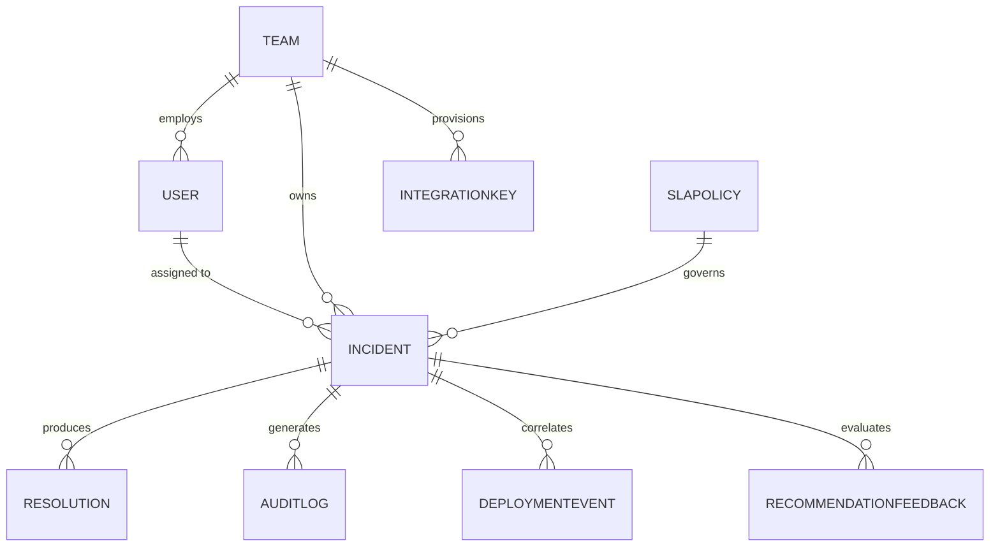

# ResolveIQ — Modular-Monolith Architecture & Data Design

## 1. Executive Architecture Overview

**ResolveIQ** is an enterprise-grade incident response, triage, and reliability platform built as a clean **Modular Monolith** using the MERN stack:
- **Client:** React (Vite) + JavaScript (JSX) + React Router v7 + Vanilla CSS design tokens.
- **Server:** Node.js + Express modular service layer + Mongoose ODM + Socket.IO realtime bus.
- **Database:** MongoDB (real Atlas or local instance, with zero-dependency memory-server fallback during isolated unit tests).
- **AI Co-Pilot:** Backend-only Google Gemini API integration (`gemini-1.5-flash`), strictly sandboxed behind structured JSON validation and a mandatory Human-in-the-Loop approval gate. If `GEMINI_API_KEY` is omitted, the system falls back seamlessly to deterministic rule-based heuristics.

### Architectural Tenets
1. **Zero Unnecessary Bloat:** No Next.js, no TypeScript, no Python sidecars, no microservices, no Redis, no Kafka. All queueing, similarity scoring, and graphs are executed in-process with deterministic algorithms.
2. **Enterprise Reliability Design:** Warm Ivory (`#F7F7F4`), Deep Charcoal (`#242824`), Muted Gray (`#747A74`), Forest Green (`#526B58`), and thin neutral borders. No neon AI gradients or purple themes.
3. **Deterministic Core:** Incident priority matrices, SLA countdown calculations, similarity scoring (TF-IDF / token overlap), and resolver routing are deterministic and verifiable.

---

## 2. Directory Layout (Modular-Monolith)

```
FSDproject/
├── client/                     # Frontend SPA (React + Vite + JSX)
│   ├── src/
│   │   ├── components/         # Reusable design system components
│   │   │   ├── common/         # StatCard, DataTable, SearchInput, Badges, Modals...
│   │   │   └── layout/         # AppLayout, Sidebar, Topbar, PageHeader...
│   │   ├── context/            # AuthContext, ToastContext...
│   │   ├── pages/              # 13 Dedicated Enterprise Views
│   │   ├── services/           # Axios API client & WebSocket listeners
│   │   ├── data/               # Isolated preview datasets (explicitly tagged)
│   │   ├── index.css           # Design tokens & enterprise utilities
│   │   ├── App.jsx             # Comprehensive Route Hierarchy
│   │   └── main.jsx
│   ├── .env.example
│   └── package.json
├── server/                     # Backend API & Realtime Server (Node + Express)
│   ├── src/
│   │   ├── config/             # DB connector & seeders
│   │   ├── models/             # Mongoose schemas (User, Team, Incident, etc.)
│   │   ├── controllers/        # Request handlers & HTTP routing logic
│   │   ├── middleware/         # Auth (JWT), RBAC, error handlers, validation
│   │   ├── routes/             # Express route definitions
│   │   ├── services/           # Business logic, similarity, AI co-pilot, SLA
│   │   ├── utils/              # Priority matrix, math calculations
│   │   ├── app.js              # Express app factory
│   │   └── server.js           # Server lifecycle & Socket.IO initialization
│   ├── tests/                  # Automated integration & unit test suites
│   ├── .env.example
│   └── package.json
├── docs/                       # Architecture, API contracts, evaluation criteria
│   ├── architecture.md
│   ├── api_contracts.md
│   └── roadmap_and_acceptance_criteria.md
├── .gitignore
├── README.md
└── package.json
```

---

## 3. Data Domain Design & Schema Relationships



### Initial Data Models:

1. **User (`User`)**
   - Fields: `name`, `email` (unique), `password` (hashed with bcrypt), `role` (`admin`, `commander`, `resolver`, `observer`), `teamId` (ref Team), `skills` (`[String]`), `activeIncidentCount`, `isActive`.
2. **Team (`Team`)**
   - Fields: `name` (unique), `tier` (`tier-1`, `tier-2`, `tier-3`), `services` (`[String]`), `onCallLead` (ref User), `description`, `escalationPolicy`.
3. **Incident (`Incident`)**
   - Fields: `incidentNumber` (`INC-1001`), `title`, `description`, `serviceName`, `environment`, `impact` (`enterprise`, `department`, `single_user`), `urgency` (`critical`, `moderate`, `low`), `priority` (`P1`-`P5`), `status` (`triggered`, `acknowledged`, `investigating`, `mitigated`, `resolved`, `closed`), `assignedTeamId` (ref Team), `assignedEngineerId` (ref User), `sla` (deadlines & breach booleans), `duplicateOf` (ref Incident), `aiHypothesis` (structured output + approval state).
4. **Resolution (`Resolution`)**
   - Fields: `incidentId` (ref Incident), `rootCauseCategory`, `remediationSteps`, `mitigatedAt`, `resolvedAt`, `authorId` (ref User), `preventionActions` (`[String]`), `runbookUrl`.
5. **AuditLog (`AuditLog`)**
   - Fields: `incidentId` (ref Incident), `actorId` (ref User), `actorName`, `actorRole`, `action` (`STATUS_TRANSITION`, `PRIORITY_OVERRIDE`, `RESOLVER_ASSIGNED`, `AI_APPROVED`), `previousState`, `newState`, `reason`, `timestamp`.
6. **SLAPolicy (`SLAPolicy`)**
   - Fields: `name`, `priorityLevel` (`P1`-`P5`), `responseTargetMinutes`, `resolutionTargetMinutes`, `businessHoursOnly` (boolean).
7. **DeploymentEvent (`DeploymentEvent`)**
   - Fields: `serviceName`, `environment`, `version`, `commitHash`, `author`, `deployedAt`, `status` (`success`, `failed`, `rolled_back`), `changeSummary`.
8. **IntegrationKey (`IntegrationKey`)**
   - Fields: `serviceName`, `provider` (`datadog`, `prometheus`, `github_actions`, `argocd`, `generic_webhook`), `apiKeyHash`, `createdBy` (ref User), `isActive`, `lastUsedAt`.
9. **RecommendationFeedback (`RecommendationFeedback`)**
   - Fields: `incidentId` (ref Incident), `recommendedEngineerId` (ref User), `wasAccepted` (boolean), `feedbackNotes`, `reviewerId` (ref User), `scoreGiven`.

### Future Schema Extensions:
- `PostMortem` (collaborative incident post-incident review documents).
- `ServiceDependencyGraph` (cached adjacency matrix for cascade blast radius).

---

## 4. Subsystems Planning

### A. Authentication & Authorization
- **JWT + bcryptjs:** Stateless tokens issued at `/api/v1/auth/login`, verified via `Authorization: Bearer <token>`.
- **Role-Based Access Control (RBAC):**
  - `admin`: Full configuration, API keys, user management.
  - `commander`: Status transitions, priority overrides, AI hypothesis approval.
  - `resolver`: Incident investigation, assignment acceptance, resolution posting.
  - `observer`: Read-only views for compliance and auditor inspection.

### B. Incident Lifecycle & SLA Processing
- Deterministic 3×3 ITIL Matrix: Impact (`enterprise`, `department`, `single_user`) $\times$ Urgency (`critical`, `moderate`, `low`) $\to$ Priority `P1`–`P5`.
- Response timers and resolution countdowns calculated on incident creation; automated breach evaluation on every read and status transition.

### C. Similarity Retrieval (Zero-Python In-Process)
- Deterministic TF-IDF / Jaccard n-gram token overlap of service, error message, stack trace snippets, and title. Flagged as duplicate when confidence $\ge 0.65$.

### D. AI Co-Pilot & Safety Gate
- Backend call to Google Gemini (`gemini-1.5-flash`).
- Rigid JSON schema parsing: `{ hypothesis: string, evidence: string[], runbook: string[] }`.
- Hypotheses remain in `pending_review` until an Incident Commander approves or rejects.
- If no Gemini key is provided, the deterministic rule-based engine generates hypothesis from correlated deployments and error signatures without error.

---

## 5. MongoDB Atlas Safe Setup Guide

To connect ResolveIQ to MongoDB Atlas safely:

1. **Create Atlas Account & Free Cluster:**
   - Go to [MongoDB Atlas](https://www.mongodb.com/cloud/atlas) and deploy an M0 Free tier cluster.
2. **Create Dedicated Database User:**
   - Under **Security > Database Access**, select **Add New Database User**.
   - Authentication Method: **Password**.
   - Username: `resolveiq_app_user`
   - Role: **Read and write to any database** (or restricted specifically to `resolveiq`).
   - Copy the generated password securely.
3. **Configure Network Access Safely:**
   - Under **Security > Network Access**, click **Add IP Address**.
   - For local development: click **Add Current IP Address** (restricts connection strictly to your development machine's public IP).
   - Alternatively for roaming dev: `0.0.0.0/0` can be configured temporarily with a strong password.
4. **Obtain Connection String:**
   - Click **Connect > Drivers > Node.js**.
   - Format: `mongodb+srv://resolveiq_app_user:<password>@cluster0.abcde.mongodb.net/resolveiq?retryWrites=true&w=majority`
5. **Set in Backend:**
   - Place this string into `server/.env` as `MONGODB_URI=...`. Never commit `server/.env`.

---

## 6. Optional Integrations & Cost Analysis

| Integration | Setup Difficulty | Operational Cost | Justification / Recommendation |
|---|---|---|---|
| **Google Gemini API** | Very Low (1 API key) | Free tier available via Google AI Studio | **Recommended.** Enriches incident triage with root cause suggestions. |
| **Datadog Webhook** | Low | Existing Datadog subscription required | **Optional.** Mock webhook endpoint built into ResolveIQ to accept standard alerts for free. |
| **GitHub Actions Ingestion** | Very Low | Free for public repos / standard GitHub | **Recommended.** Real deployment correlation webhook. |
| **Kafka / RabbitMQ** | High (Infrastructure complexity) | Server hosting / RAM overhead | **Rejected.** Socket.IO and Mongoose provide all necessary event throughput for a modular monolith. |
| **Elasticsearch** | High (Requires JVM + cluster) | High memory requirements | **Rejected.** MongoDB text index and in-memory TF-IDF handle duplicate search natively. |
